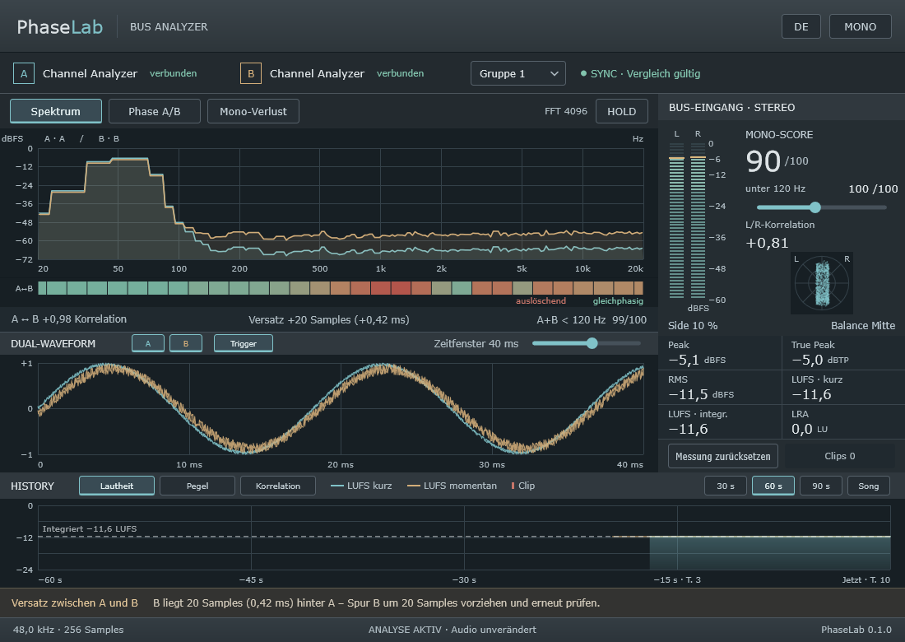
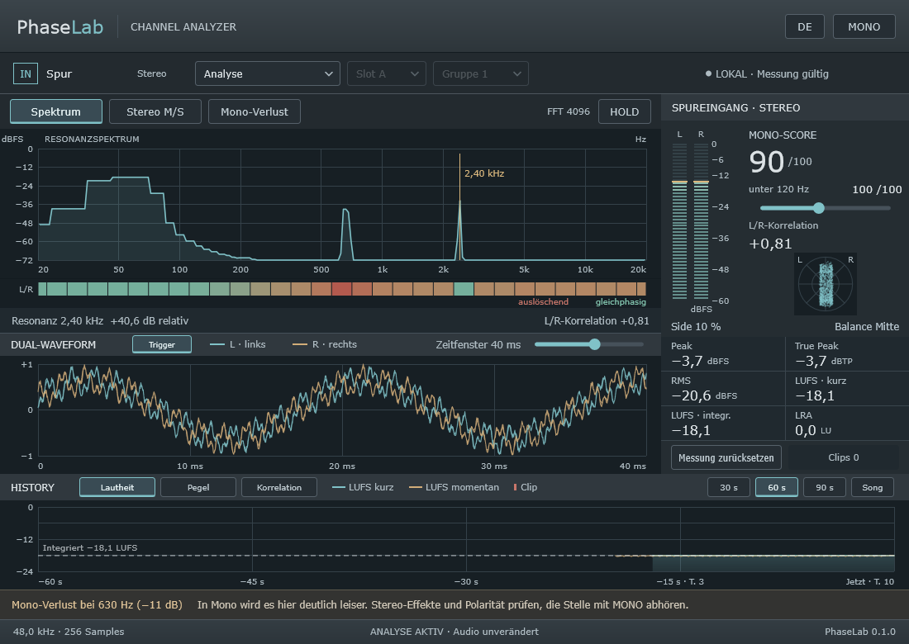
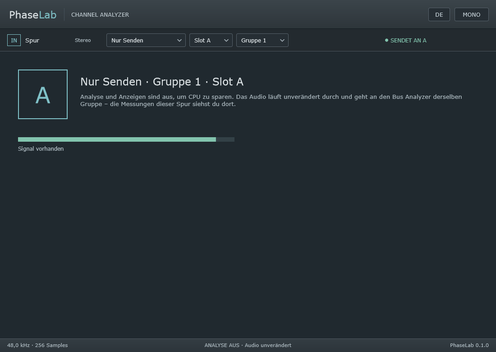

# PhaseLab – Handbuch

PhaseLab zeigt dir, wie sich deine Spuren in Phase, Mono und Stereo verhalten, und erklärt in
verständlichen Worten, was du prüfen kannst. Es gibt zwei Plugins:

- **PhaseLab Channel Analyzer** kommt auf eine Spur. Er analysiert sie und kann sie als Quelle A oder B
  an den Bus Analyzer schicken.
- **PhaseLab Bus Analyzer** kommt auf einen Bus oder den Master. Er misst sein eigenes Signal und
  vergleicht zwei Spuren miteinander, etwa Kick und Bass.

PhaseLab analysiert nur, dein Audio läuft unverändert durch. Die einzige Ausnahme ist der Schalter
**MONO** zum Abhören (siehe unten).

> Version 0.1.1. Getestet mit eigenen Tests und pluginval unter Windows. In DAWs und unter macOS/Linux
> noch nicht geprüft.

## 1. Installation

Lade die Pakete für dein System aus dem Release auf GitHub.

| System | VST3 | CLAP | AU |
|---|---|---|---|
| Windows | `C:\Program Files\Common Files\VST3` | `%LOCALAPPDATA%\Programs\Common\CLAP` | – |
| macOS (Apple Silicon) | `~/Library/Audio/Plug-Ins/VST3` | `~/Library/Audio/Plug-Ins/CLAP` | `~/Library/Audio/Plug-Ins/Components` |
| Linux | `~/.vst3` | `~/.clap` | – |

Danach in der DAW nach neuen Plugins suchen lassen. Die Plugins heißen „PhaseLab Channel Analyzer“ und
„PhaseLab Bus Analyzer“, Hersteller „sscheppert-blip“.

### macOS

Die Plugins sind nicht von Apple notarisiert, deshalb blockiert macOS sie zunächst. Einmal im Terminal
ausführen und die DAW neu starten:

```bash
xattr -dr com.apple.quarantine ~/Library/Audio/Plug-Ins/VST3/PhaseLab*.vst3 ~/Library/Audio/Plug-Ins/CLAP/PhaseLab*.clap ~/Library/Audio/Plug-Ins/Components/PhaseLab*.component
```

## 2. Schnellstart: Kick und Bass vergleichen

1. Auf die Kick-Spur den **Channel Analyzer** legen: *Analyse + Senden*, *Slot A*, *Gruppe 1*.
2. Auf die Bass-Spur ebenfalls einen **Channel Analyzer**: *Analyse + Senden*, *Slot B*, *Gruppe 1*.
3. Auf den gemeinsamen Bus oder den Master den **Bus Analyzer**, *Gruppe 1*.
4. Wiedergabe starten. Oben rechts erscheint „SYNC · Vergleich gültig“.



Der Bus Analyzer zeigt jetzt die Spektren von Kick und Bass übereinander. Darunter siehst du, in
welchen Frequenzbereichen sich beide auslöschen, sowie Korrelation, Versatz und wie gut sie sich im
Bass addieren. Die Hinweiszeile unten sagt dir, was zu tun ist, z. B. „B liegt 20 Samples hinter A –
Spur B um 20 Samples vorziehen“.

## 3. Channel Analyzer



### Betriebsart, Slot, Gruppe

| Betriebsart | Was passiert |
|---|---|
| **Analyse** | Nur die Spur selbst wird analysiert, nichts wird gesendet. |
| **Analyse + Senden** | Analyse und gleichzeitig Quelle A oder B für den Bus Analyzer der gewählten Gruppe. |
| **Nur Senden** | Analyse und Anzeigen sind aus, das spart CPU. Das Fenster zeigt nur Slot, Gruppe und ob Signal anliegt. |

**Slot** (A/B) und **Gruppe** (1–4) bestimmen, an welchen Bus Analyzer die Spur geht. Pro Gruppe gibt es
genau einen Slot A und einen Slot B. Will ein zweiter Channel Analyzer denselben Slot belegen, meldet er
„Slot A belegt“. Zwei Quellen werden nie vermischt.

Den Spurnamen übernimmt PhaseLab vom Host, wenn das Format ihn liefert.



## 4. Die Ansichten

Über die Knöpfe oben wählst du, was der große Graph zeigt:

- **Spektrum**: im Channel Analyzer das Resonanzspektrum der Spur mit Markierung der auffälligsten
  schmalen Überhöhung. Im Bus Analyzer A und B übereinander, solange der Vergleich gültig ist, sonst das
  eigene Eingangssignal.
- **Stereo M/S** (Channel Analyzer): Mitten- und Seitensignal getrennt.
- **Phase A/B** (Bus Analyzer): um wie viel Grad B gegenüber A je Terzband verschoben ist. 0° heißt
  gleichphasig (addiert sich), ±180° gegenphasig (löscht sich aus). Ein zeitlicher Versatz erscheint
  als Linie, die mit der Frequenz abfällt. Deutlich gezeichnet werden nur Bänder, in denen A und B
  zusammenhängen (Band-Korrelation ab 0,3), die anderen nur blass. Bei Kick gegen Bass sind das oft
  wenige, bei Bass DI gegen Amp oder zwei Mikros an einer Trommel fast alle.
- **Mono-Verlust**: wie viele dB die Monosumme je Frequenzbereich verliert. Null heißt: kein Verlust.

**Band-Streifen** unter dem Graphen: die Korrelation je Terzband. Grün bedeutet gleichphasig, rot
auslöschend, grau zu leise. Im Channel Analyzer zwischen L und R, im Bus Analyzer zwischen A und B.

**Dual-Waveform**: L/R bzw. A/B auf derselben Zeitachse. Mit dem Regler in der Titelleiste wählst du
das Zeitfenster von 2 ms (einzelne Schwingungen und Samples) bis 400 ms (viele Bass-Wellen, Kick und
Bass im Zusammenspiel); Doppelklick setzt 40 ms. Bei langen Fenstern zeigt jeder Bildpunkt die Spanne
vom tiefsten bis zum höchsten Wert, wie eine Waveform in der DAW. Die Einstellung wird im Projekt
gespeichert.

Im Bus Analyzer blenden die Schalter **A** und **B** eine Kurve aus – in der Waveform und im
A/B-Spektrum (sie erscheinen, solange der A/B-Vergleich gültig ist). **Trigger** (Standard: an) lässt das Bild wie bei einem Oszilloskop
immer an einem aufsteigenden Nulldurchgang des Basses von A bzw. L beginnen. Periodische Signale stehen
dann still, und du kannst die Lage der Berge und Täler von A und B in Ruhe vergleichen.

**HOLD** hält die Anzeige an, das Audio läuft weiter.

## 5. Rechte Spalte: Messwerte

- **Pegel L/R**: Spitzenpegel mit Peak-Hold.
- **MONO-SCORE** 0–100: wie viel Energie die Monosumme gegenüber einem perfekt gleichphasigen Signal
  behält. Gleiche Kanäle ergeben 100, gegenphasige 0. Gleich laute, unabhängige Kanäle liegen bei etwa
  50, für breite Pads ist das normal. Der Score ist ein Hinweis, kein Qualitätsurteil.
- **unter … Hz**: derselbe Score nur für den Bassbereich. Mit dem Regler verschiebst du die
  Grenzfrequenz zwischen 40 und 500 Hz, Standard ist 120 Hz.
- **L/R-Korrelation**, **Goniometer**, **Side**-Anteil und **Balance**. Hinweis: In den meisten DAWs
  wirkt der Pan-Regler einer Spur erst *nach* den Insert-Plugins. Der Channel Analyzer sieht daher das
  ungepannte Signal – eine Mono-Spur bleibt in der Mitte. Die gepannte Summe zeigt der Bus Analyzer.
- **Peak**, **True Peak**, **RMS** (300 ms), **LUFS kurz** (3 s), **LUFS integriert** und **LRA**. Gemessen
  nach ITU-R BS.1770 / EBU R128. True Peak über −1 dBTP wird orange.
- **Messung zurücksetzen** startet Peak, True Peak, integrierte Lautheit, LRA und History neu.

## 6. History

Die History zeigt den Verlauf über die Zeit – ähnlich der Zeitleiste eines Loudness-Meters. Mit den
Knöpfen links wählst du, was sie zeigt (die Wahl wird im Projekt gespeichert):

- **Lautheit** (Standard): LUFS kurz als gefüllte Fläche, LUFS momentan als Linie und die integrierte
  Lautheit seit dem Zurücksetzen als gestrichelte Linie mit Wert.
- **Pegel**: Peak als gefüllte Hüllkurve, RMS als Linie, in dBFS.
- **Korrelation**: L/R-Korrelation und Mono-Score (eigene Achse rechts, 0–100).

Clips sind in Lautheit und Pegel rot markiert. Rechts wählst du das Zeitfenster: **30, 60 oder 90 s**
(die letzten Sekunden, fein aufgelöst) oder **Song** – den ganzen Verlauf seit dem letzten Zurücksetzen,
bis zu zwei Stunden, mit Minuten und Takten an der Zeitachse. Aufgezeichnet wird, während der Host
abspielt; Stopp-Pausen erzeugen keine Lücken. „Messung zurücksetzen“ beginnt den Verlauf neu.

Die Kurven sind zur besseren Lesbarkeit geglättet, die Skala passt sich dem sichtbaren Material an.
Liefert der Host Takt und Tempo, steht unter der Zeitachse auch der Takt (z. B. „T. 33“).

## Clipping

Ein Sample bei 0 dBFS oder darüber zählt als Clipping. Mehrere direkt aufeinanderfolgende Samples sind
ein Clip. PhaseLab zeigt:

- eine rote Clip-LED über dem Pegelmeter des betroffenen Kanals (leuchtet 3 Sekunden),
- den Zähler „Clips N · M Samples“ seit dem letzten Zurücksetzen, rot sobald etwas geclippt hat,
- Peak und True Peak in Rot, sobald sie 0 dB erreichen,
- rote Marken in der History (Ansicht Pegel),
- und als ersten Hinweis „Clipping“, solange es in den letzten 3 Sekunden geclippt hat.

„Messung zurücksetzen“ setzt den Zähler zurück.

## 7. Hinweise

Die Zeile über der Fußleiste nennt die wichtigste Beobachtung mit einem konkreten Vorschlag, was du
prüfen oder abhören kannst. Zum Beispiel:

- „Unter 120 Hz nicht monotauglich“: Stereo-Verbreiterung im Bass prüfen.
- „Mono-Verlust bei 630 Hz“
- „True Peak über −1 dBTP“
- „Schmale Überhöhung bei 2,4 kHz“
- Im Bus Analyzer: Versatz oder Polarität zwischen A und B, Auslöschung in einem Bassband, schlechte
  Summe A+B.

PhaseLab ändert nie selbst etwas. Was du davon umsetzt, entscheidest du.

## 8. MONO

**MONO** oben rechts summiert den Ausgang des Plugins zum Abhören zu Mono. Die Analyse misst dabei
weiter das unveränderte Original. Eine orange Leiste erinnert dich daran. Der Schalter wird nicht mit
dem Projekt gespeichert und ist nach dem Laden immer aus, damit kein Export versehentlich mono wird.

## 9. Wann der A/B-Vergleich gültig ist

Werte wie Korrelation, Versatz und Phase zwischen A und B zeigt der Bus Analyzer nur, wenn die Daten
beider Spuren sicher zur selben Zeit gehören.

| Anzeige | Bedeutung |
|---|---|
| SYNC · Vergleich gültig | Alles in Ordnung |
| Quelle fehlt | A oder B sendet nicht, oder die Gruppe stimmt nicht |
| Quelle liefert keine Daten | Wiedergabe gestoppt, Spur stumm/gebypasst oder Plugin entfernt |
| Wiedergabe starten | Ohne laufende Timeline gibt es keinen gemeinsamen Zeitbezug |
| Synchronisiere … / Lücke | Nach Start, Sprung oder Loop, gleich wieder gültig |
| Offline-Rendern | Beim schnellen Export gesperrt (noch nicht für alle Hosts geprüft) |
| Samplerate verschieden | A und B laufen mit unterschiedlicher Samplerate |

## 10. Bekannte Grenzen

- Bisher nur unter Windows getestet, noch in keiner DAW.
- Die Formel für den Mono-Score ist ein Entwurf und wird noch kalibriert.
- Zwei gleichzeitig offene DAW-Projekte teilen sich die Gruppen 1–4.
- Der True Peak nutzt ein eigenes 4-fach-Oversampling, nicht den Referenzfilter der Norm.

## Lizenz

Public Domain (Unlicense). Die Plugins sind mit JUCE gebaut, das eigene Lizenzbedingungen hat (AGPLv3).
