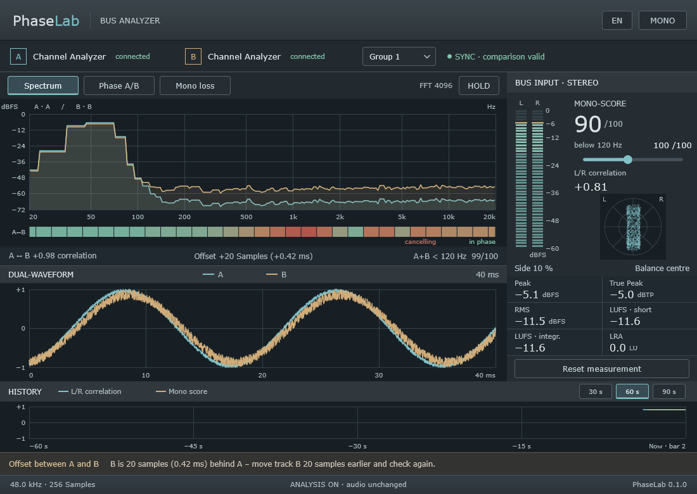
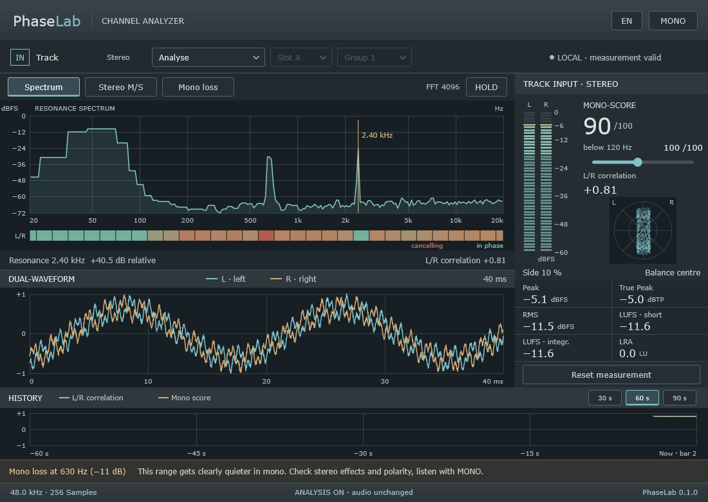
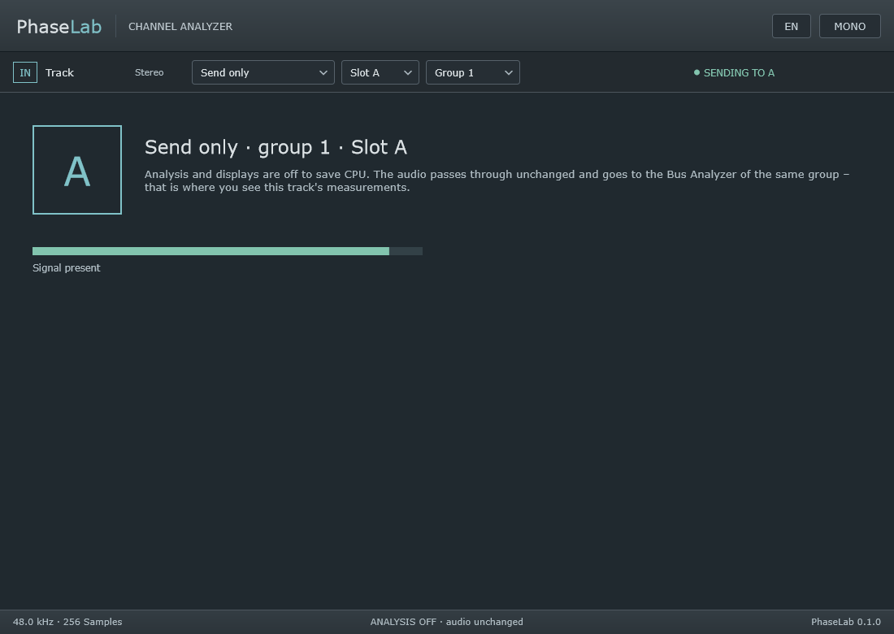

# PhaseLab – Manual

PhaseLab shows how your tracks behave in phase, mono and stereo, and explains in plain words what to
check. There are two plugins:

- **PhaseLab Channel Analyzer** goes on a track. It analyses the track and can send it to the Bus
  Analyzer as source A or B.
- **PhaseLab Bus Analyzer** goes on a bus or the master. It measures its own signal and compares two
  tracks, for example kick and bass.

PhaseLab only analyses – your audio passes through unchanged. The one exception is the **MONO**
listening switch (see below).

> Version 0.1.0. Tested with its own tests and pluginval on Windows. Not yet tested in DAWs or on
> macOS/Linux.

## 1. Installation

Download the packages for your system from the GitHub release.

| System | VST3 | CLAP | AU |
|---|---|---|---|
| Windows | `C:\Program Files\Common Files\VST3` | `%LOCALAPPDATA%\Programs\Common\CLAP` | – |
| macOS (Apple Silicon) | `~/Library/Audio/Plug-Ins/VST3` | `~/Library/Audio/Plug-Ins/CLAP` | `~/Library/Audio/Plug-Ins/Components` |
| Linux | `~/.vst3` | `~/.clap` | – |

Then let your DAW scan for new plugins. They are called "PhaseLab Channel Analyzer" and "PhaseLab Bus
Analyzer", manufacturer "sscheppert-blip".

### macOS

The plugins are not notarized by Apple, so macOS blocks them at first. Run this once in Terminal and
restart the DAW:

```bash
xattr -dr com.apple.quarantine ~/Library/Audio/Plug-Ins/VST3/PhaseLab*.vst3 ~/Library/Audio/Plug-Ins/CLAP/PhaseLab*.clap ~/Library/Audio/Plug-Ins/Components/PhaseLab*.component
```

## 2. Quick start: kick vs. bass

1. On the kick track: **Channel Analyzer**, *Analyse + send*, *Slot A*, *Group 1*.
2. On the bass track: another **Channel Analyzer**, *Analyse + send*, *Slot B*, *Group 1*.
3. On their common bus or the master: **Bus Analyzer**, *Group 1*.
4. Start playback – the top right shows "SYNC · comparison valid".



The Bus Analyzer now shows the spectra of kick and bass on top of each other, the frequency bands where
they cancel, their correlation, time offset and how well they add up in the low end. The hint line at
the bottom tells you what to do, for example "B is 20 samples behind A – move track B 20 samples
earlier".

## 3. Channel Analyzer



### Mode, slot, group

| Mode | What happens |
|---|---|
| **Analyse** | Only the track itself is analysed; nothing is sent. |
| **Analyse + send** | Analysis plus source A or B for the Bus Analyzer of the chosen group. |
| **Send only** | Analysis and displays are off to save CPU. The window shows slot, group and whether there is signal. |

**Slot** (A/B) and **group** (1–4) decide which Bus Analyzer receives the track. Each group has exactly
one slot A and one slot B; a second Channel Analyzer on the same slot shows "Slot A in use" – two
sources are never mixed. The track name comes from the host where the format provides it.



## 4. Views

The buttons above the big graph choose what it shows:

- **Spectrum** – in the Channel Analyzer the resonance spectrum of the track, with the most striking
  narrow peak marked; in the Bus Analyzer A and B on top of each other while the comparison is valid,
  otherwise its own input.
- **Stereo M/S** (Channel Analyzer) – mid and side signal separately.
- **Phase A/B** (Bus Analyzer) – the phase of B relative to A per third octave.
- **Mono loss** – how many dB the mono sum loses per frequency band. Zero means nothing is lost.

**Band strip** below the graph: correlation per third octave – green in phase, red cancelling, grey too
quiet. In the Channel Analyzer between L and R, in the Bus Analyzer between A and B.

**Dual waveform**: the last 40 ms of L/R or A/B on the same time axis.

**HOLD** freezes the display; the audio keeps running.

## 5. Right column: measurements

- **Level L/R** with peak hold.
- **MONO SCORE** 0–100: how much energy the mono sum keeps compared with a perfectly coherent signal.
  Identical channels give 100, opposite polarity 0, equally loud unrelated channels about 50 (normal
  for wide pads). A hint, not a verdict on quality.
- **below … Hz**: the same score for the low end only; move the cutoff between 40 and 500 Hz with the
  slider (default 120 Hz).
- **L/R correlation**, **goniometer**, **side** share and **balance**.
- **Peak**, **true peak**, **RMS** (300 ms), **LUFS short** (3 s), **LUFS integrated** and **LRA** after
  ITU-R BS.1770 / EBU R128. True peak above −1 dBTP turns orange.
- **Reset measurement** restarts peak, true peak, integrated loudness, LRA and history.

## 6. History

The L/R correlation (teal) and mono score (sand) of the last 30, 60 or 90 seconds. When the host
provides bars and tempo, the time axis also shows the bar ("bar 33"), so you find the spot in the
arrangement again.

## 7. Hints

The line above the footer names the most important observation with a concrete suggestion what to check
or listen to. Examples:

- "Below 120 Hz not mono-safe" – check stereo widening in the low end.
- "Mono loss at 630 Hz"
- "True peak above −1 dBTP"
- "Narrow peak at 2.4 kHz"
- In the Bus Analyzer: offset or polarity between A and B, cancelling in a low band, a poor sum A+B.

PhaseLab never changes anything itself – you decide what to do.

## 8. MONO

**MONO** at the top right sums the plugin's output to mono for listening. The analysis still measures
the unchanged original, and an orange bar reminds you. The switch is not saved with the project and is
always off after loading, so no export turns mono by accident.

## 9. When the A/B comparison is valid

The Bus Analyzer shows A/B values (correlation, offset, phase) only when the data of both tracks is
known to belong to the same moment:

| Display | Meaning |
|---|---|
| SYNC · comparison valid | all good |
| Source missing | A or B is not sending, or the group does not match |
| Source sends no data | playback stopped, track muted/bypassed or plugin removed |
| Start playback | without a running timeline there is no common time |
| Synchronising … / Gap | after start, jump or loop – valid again shortly |
| Offline render | locked during fast export (not yet verified in every host) |
| Different sample rates | A and B run at different sample rates |

## 10. Known limits

- So far only tested on Windows, not yet in a DAW.
- The mono score formula is a draft and still to be calibrated.
- Two DAW projects open at the same time share groups 1–4.
- True peak uses its own 4x oversampling, not the reference filter of the standard.

## License

Public domain (Unlicense). The plugins are built with JUCE, which has its own license terms (AGPLv3).
